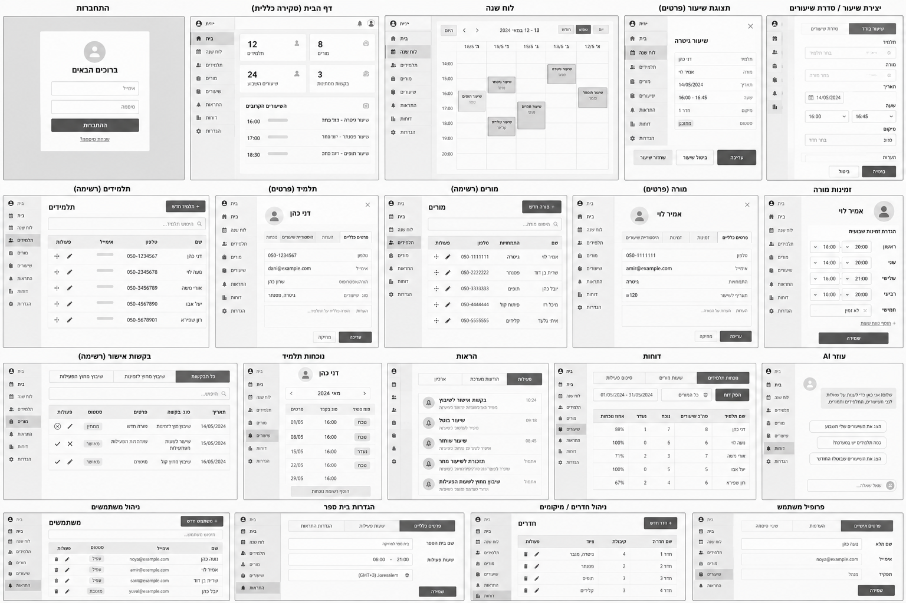
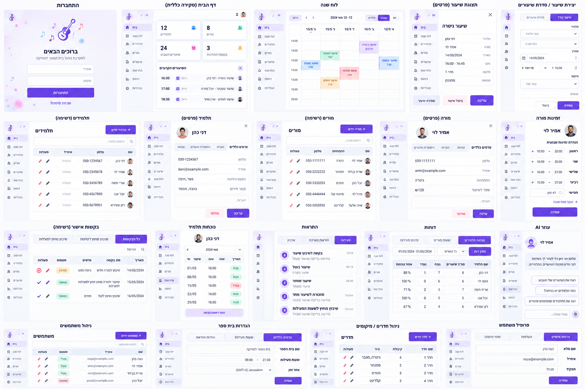
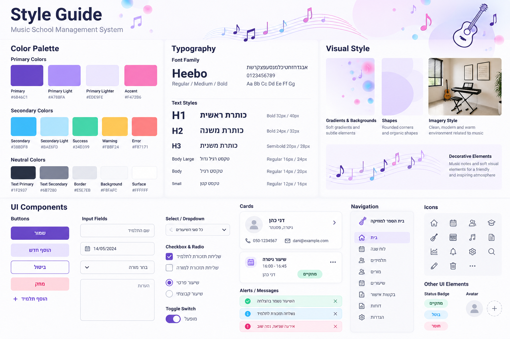

# DESIGN — מערכת לניהול בית ספר למוזיקה

**מקורות:** `PRD.md`, `wireframes.png`, `style-guide.png`, `mockups.png`  
**שפת ממשק:** עברית, RTL  
**פלטפורמה:** Web Application רספונסיבית; ממשקי מנהל ומורה מבוססים על אותה שפה עיצובית.

> סדר העדיפויות במקרה של אי־התאמה: ה־PRD קובע יכולות והרשאות; ה־Wireframes קובעים את מבנה התצוגות; ה־Style Guide קובע את השפה החזותית; ה־Mockups מדגימים את שילובם. רכיבים שמופיעים בתמונות אך אינם מאושרים ב־PRD אינם מהווים דרישת פיתוח.

## 1. Screens — מסכי האפליקציה

### מקורות חזותיים למבנה ולתוצאה

ה־Wireframes וה־Mockups מציגים 19 תצוגות על לוח אחד. חלק מהתצוגות הן פרטי ישות או טופס הנפתח מתוך מסך רשימה, ולא בהכרח Route עצמאי. המימוש יכול להשתמש ב־Page, Drawer או Dialog לפי המבנה המוצג, ללא שינוי הפעולות המותרות ב־PRD.

### 1.1 התחברות
- **מטרה:** כניסת משתמש קיים למערכת.
- **מבנה ותוכן:** אזור מרכזי עם כותרת „ברוכים הבאים”, שדות „אימייל” ו„סיסמה”, כפתור „התחברות” וקישור „שכחת סיסמה?”. רקע בהיר עם מוטיבים מוזיקליים עדינים.
- **פעולות וניווט:** התחברות והמשך לממשק לפי תפקיד; מעבר לתהליך איפוס סיסמה. תהליך האיפוס מוגדר ב־PRD אך אינו מוצג כ־Mockup נפרד.

### 1.2 דף הבית (סקירה כללית)
- **מטרה:** תמונת מצב מהירה של פעילות בית הספר למנהל.
- **מבנה ותוכן:** Sidebar מימין לפי RTL; כרטיסי מדדים בחלק העליון; אזור „השיעורים הקרובים” עם שעות ופרטי שיעור.
- **פעולות וניווט:** כניסה ללוח השנה, תלמידים, מורים, שיעורים, בקשות, התראות והגדרות דרך הניווט. למורה מוצג תוכן אישי והרשאות מצומצמות בהתאם ל־PRD, ולא כל נתוני בית הספר.

### 1.3 לוח שנה
- **מטרה:** צפייה בשיעורים לפי תאריך ושעה.
- **מבנה ותוכן:** Toolbar לבחירת תאריך ומצב יום/שבוע/חודש; Grid של שעות וימים; בלוקי שיעורים בגווני Accent שונים; Sidebar קבוע במחשב.
- **פעולות וניווט:** מעבר בין תאריכים ותצוגות, סינון, פתיחת פרטי שיעור ויצירת שיעור לפי הרשאה. מסנן „הצג שיעורים מבוטלים” בהתאם ל־PRD.

### 1.4 תצוגת שיעור (פרטים)
- **מטרה:** צפייה בפרטי שיעור ובמצבו.
- **מבנה ותוכן:** פאנל פרטים עם תלמיד, מורה, תאריך, שעה, תחום וסטטוס; פעולות בתחתית הפאנל.
- **פעולות וניווט:** חזרה ללוח; עריכה, ביטול או שחזור בהתאם להרשאות ולסטטוס. אזהרות ואישורים מוצגים כ־Dialog, לא כמסך נוסף.

### 1.5 יצירת שיעור / סדרת שיעורים
- **מטרה:** הגדרת שיבוץ חד־פעמי או חוזר.
- **מבנה ותוכן:** בחירת סוג שיעור, תלמיד, מורה, תאריך, שעה ומשך; בחירה בין „שיעור בודד” ל„סדרת שיעורים”; פעולות „ביטול” ו„שמירה”.
- **פעולות וניווט:** שמירה בכפוף לבדיקות זמינות והתנגשויות; חזרה ללוח השנה. כאשר נדרש אישור מורה, יש להציג את סטטוס הבקשה לפי ה־PRD.

### 1.6 תלמידים (רשימה)
- **מטרה:** איתור וניהול תלמידים.
- **מבנה ותוכן:** כותרת „תלמידים”, חיפוש, כפתור „תלמיד חדש”, טבלת תלמידים עם פרטים ופעולות.
- **פעולות וניווט:** פתיחת פרטי תלמיד, הוספה, עריכה וסינון בהתאם להרשאה.

### 1.7 תלמיד (פרטים)
- **מטרה:** הצגת מידע אישי ומקצועי של תלמיד.
- **מבנה ותוכן:** כותרת עם שם, Tabs כגון „פרטים כלליים”, „הערות” ו„היסטוריית שיעורים”; שדות מידע ופעולות עריכה.
- **פעולות וניווט:** מעבר בין Tabs, עדכון שדות מורשים וחזרה לרשימה. למורה יש להציג עריכה של מידע מקצועי בלבד ובתחומים המותרים לו.

### 1.8 מורים (רשימה)
- **מטרה:** איתור וניהול מורים.
- **מבנה ותוכן:** כותרת „מורים”, חיפוש, „מורה חדש”, טבלה עם שם, תחומי הוראה, טלפון ופעולות.
- **פעולות וניווט:** פתיחת פרופיל מורה, הוספה ועריכה לפי הרשאה.

### 1.9 מורה (פרטים)
- **מטרה:** צפייה בפרטי מורה ובמידע המקצועי שלו.
- **מבנה ותוכן:** כותרת עם שם, Tabs לפרטים, זמינות והיסטוריית שיעורים; שדות טלפון, אימייל ותחומי הוראה.
- **פעולות וניווט:** עדכון פרטים, מעבר לזמינות וחזרה לרשימה. הרשאות עריכה תלויות בתפקיד ובסטטוס המורה.

### 1.10 זמינות מורה
- **מטרה:** הצגה והגדרה של חלונות זמינות שבועיים.
- **מבנה ותוכן:** רשימת ימי השבוע, שדות שעות התחלה וסיום, אפשרות הוספת טווח זמינות וכפתור „שמירה”.
- **פעולות וניווט:** הוספת זמינות; הסרת זמינות מחייבת אישור מנהל לפי ה־PRD. ניתן להגיע מתצוגת המורה.

### 1.11 בקשות אישור (רשימה)
- **מטרה:** טיפול בבקשות לשינויים ואישורים.
- **מבנה ותוכן:** Tabs או מסנני סוג בקשה, חיפוש, טבלה עם תאריך, סוג, פרטים, סטטוס ופעולות.
- **פעולות וניווט:** פתיחת בקשה, אישור או דחייה לפי תפקיד, וצפייה בהיסטוריה. מנהלים עובדים על תור משותף.

### 1.12 נוכחות תלמיד
- **מטרה:** צפייה ודיווח נוכחות במפגשים המשויכים לתלמיד או למורה.
- **מבנה ותוכן:** כותרת עם שם תלמיד, בחירת חודש, רשימת מפגשים ותוויות סטטוס נוכחות.
- **פעולות וניווט:** הזנה או תיקון סטטוס, בהתאם להרשאות; חזרה לפרטי התלמיד או השיעור.

### 1.13 התראות
- **מטרה:** צפייה בהודעות מערכת ובבקשות שדורשות תשומת לב.
- **מבנה ותוכן:** Tabs כגון „פעילות”, „הודעות מערכת” ו„ארכיון”; רשימת הודעות עם אייקון, תיאור וזמן.
- **פעולות וניווט:** פתיחת פריט קשור, סימון כנקרא והעברה לארכיון. אין מחיקה לצמיתות דרך הממשק.

### 1.14 דוחות
- **מטרה:** הצגת סיכומי פעילות ניהוליים פשוטים.
- **מבנה ותוכן:** כותרת „דוחות”, מסנני תקופה ומורה, טבלה מסכמת עם מדדי שיעורים ונוכחות.
- **פעולות וניווט:** בחירת מסננים וצפייה בנתונים. **הסתייגות:** ה־PRD מחריג דוחות מתקדמים; אין לפרש את התצוגה כהיתר להוסיף מודול Analytics מתקדם.

### 1.15 עוזר AI
- **מטרה:** חיפוש מידע והצעת אפשרויות למנהלים.
- **מבנה ותוכן:** אזור שיחה, הודעת פתיחה, הצעות שאילתות ושדה „שאל שאלה...”.
- **פעולות וניווט:** הזנת שאלה וקבלת תשובה. אין פעולות אוטונומיות המשנות נתונים; המסך זמין למנהלים בלבד.

### 1.16 ניהול משתמשים
- **מטרה:** ניהול חשבונות והרשאות.
- **מבנה ותוכן:** כותרת „משתמשים”, חיפוש, כפתור הוספה וטבלה עם שם, אימייל, תפקיד, סטטוס ופעולות.
- **פעולות וניווט:** צפייה וניהול בהתאם להרשאה; ניהול מנהלים והרשאותיהם מוגבל ל־Super Admin.

### 1.17 הגדרות בית ספר
- **מטרה:** עריכת פרטי בית הספר והגדרות תפעוליות.
- **מבנה ותוכן:** Tabs להגדרות כלליות, שעות פעילות והגדרות רלוונטיות; טופס פרטי בית הספר ושמירה.
- **פעולות וניווט:** מעבר בין קבוצות ההגדרות ושמירה. שעות פעילות, ימי סגירה ותחומי לימוד ינוהלו בהתאם ל־PRD.

### 1.18 ניהול חדרים / מיקומים — תצוגה במקור החזותי בלבד
- **מבנה בתמונות:** רשימת חדרים, מספר/שם חדר, קיבולת, ציוד ופעולות.
- **הבהרת תחולה:** מסך זה מופיע ב־Wireframes וב־Mockups, **אך ניהול חדרים מוחרג במפורש מה־MVP ב־PRD**. לכן הוא מתועד כאן רק כדי לשקף נאמנה את התמונה, ואינו חלק מהמימוש המאושר. אין להוסיף אותו לניווט הפעיל.

### 1.19 פרופיל משתמש
- **מטרה:** צפייה בפרטי החשבון ובהעדפות האישיות.
- **מבנה ותוכן:** Tabs לפרטים אישיים, העדפות ושינוי סיסמה; שדות שם, אימייל ותפקיד; כפתור „שמירה”.
- **פעולות וניווט:** עדכון הגדרות אישיות מותרות, לרבות העדפות התראות לפי ה־PRD. תפקיד והרשאות אינם ניתנים לשינוי עצמי.

### מבנה ניווט כללי

ב־Desktop ניווט צדדי קבוע ב־RTL, עם כותרת מסך ואזור תוכן מרכזי. רשימות מובילות לפרטים, ולוח השנה מוביל לפרטי שיעור ולפעולות שיבוץ. אזורים כגון התראות, בקשות והגדרות נגישים מתוך הניווט המתאים לתפקיד. המנהל רואה יכולות ניהול רחבות; המורה רואה רק את לוח השיעורים שלו, זמינות, תלמידים משויכים, בקשות, נוכחות והעדפות מורשות. ב־Tablet וב־Mobile יש להתאים את פריסת אותם רכיבים לשטח הזמין, בלי להוסיף מסכים או פעולות חדשות. ה־Mockups הקיימים מדגימים בעיקר Desktop; **אין בהם מפרט ויזואלי סופי ל־Tablet ול־Mobile**.

## 2. Style Guide — השפה העיצובית

### 2.1 Color Palette

הערכים הבאים מוצגים ב־Style Guide ומשמשים כ־Design Tokens. יש לשמור על הפרדה בין צבע תפקיד (Semantic Token) לבין צבע רכיב מסוים.

| Token | HEX | שימוש עיקרי |
|---|---|---|
| Primary | `#6B46C1` | פעולות ראשיות, ניווט פעיל |
| Primary Light | `#A78BFA` | הדגשות משניות |
| Primary Lighter | `#EDE9FE` | רקעי בחירה ומשטחים עדינים |
| Accent | `#F472B6` | הדגשה דקורטיבית מוגבלת |
| Secondary | `#38BDF8` | הדגשות מידע |
| Secondary Light | `#BAE6FD` | רקע מידע בהיר |
| Success | `#34D399` | סטטוס הצלחה |
| Warning | `#FBBF24` | אזהרות |
| Error | `#F87171` | שגיאות ופעולות מסוכנות |
| Text Primary | `#1F2937` | טקסט ראשי |
| Text Secondary | `#6B7280` | טקסט משני |
| Border | `#ABB2BF` | קווי הפרדה וגבולות (כרטיסים, תפריט צד, פס עליון, כפתורי Outline אפורים). ערך ה־Style Guide המקורי `#E5E7EB` הוכהה ב־20% לשיפור הנראות |
| Input Border | `#6B7280` | גבול של כל שדות הקלט (Input, Select, Textarea) בכל המסכים; עומד בקונטרסט 3:1 של WCAG לרכיבים על רקע לבן |
| Input Border Hover | `#4B5563` | גבול שדה במעבר עכבר |
| Background | `#F8FAFC` | רקע עמוד |
| Surface | `#FFFFFF` | כרטיסים, טפסים ומשטחים |

הגוונים והקונטרסט בפועל חייבים להיבדק מול טקסט קטן, מצבי Focus ו־WCAG; אין להסתמך על צבע בלבד לציון סטטוס.

### 2.2 Typography

- **Font Family:** `Heebo`, עם גיבוי ל־sans-serif התומך בעברית.
- **Weights:** Regular, Medium, Semibold, Bold.
- **H1:** `32px / 40px`, Bold.
- **H2:** `24px / 32px`, Bold.
- **H3:** `20px / 28px`, Semibold.
- **Body Large:** `16px / 24px`, Regular.
- **Body:** `14px / 20px`, Regular.
- **Small:** `12px / 16px`, Regular.

כותרות וטקסטים בעברית מיושרים לימין. מספרי טלפון, אימייל, כתובות URL וקטעי קוד שומרים על סדר תווים קריא בהתאם לתוכנם.

### 2.3 UI Style

- **Buttons:** כפתור Primary סגול עם טקסט לבן; Secondary עם רקע לילך בהיר; Outline לבן עם גבול סגול; פעולת מחיקה בגווני ורוד/אדום בהיר. בדוגמאות: „שמירה”, „הוסף חדש”, „ביטול”, „מחק”.
- **Input Fields:** משטח לבן, גבול אפור כהה (`Input Border`, זהה בכל השדות במערכת; Focus — גבול סגול עם טבעת מיקוד; שגיאה — גבול `Error`), פינות מעוגלות, Label או Placeholder בעברית ומיושר לימין; תאריכים ושעות מוצגים באופן קריא.
- **Select / Dropdown:** שפה זהה לשדות הקלט, עם סימון פתיחה ברור.
- **Checkbox / Radio / Toggle:** Accent סגול במצב נבחר; טקסט תווית מימין בהתאם ל־RTL.
- **Cards:** משטח לבן, גבול עדין או Shadow רך, פינות מעוגלות, חלוקה ברורה בין כותרת, נתונים ופעולות.
- **Navigation:** Sidebar בהיר; אייקון ותווית; פריט פעיל עם רקע לילך וסימון סגול; ניווט עקבי בין מסכים.
- **Status Badges:** תוויות קצרות עם רקע עדין, כגון „מתקיים”, „בוטל”, „חוסר”; בכל מקום להעדיף ניסוח סטטוס מדויק מה־PRD.
- **Alerts:** הודעות מידע, הצלחה ושגיאה ברקע בהיר תואם לצבע הסמנטי, עם אייקון וטקסט מפורש. גבול ההודעה הוא הגוון הבהיר של הצבע הסמנטי מוכהה ב־20%: מידע `#57C2FA`, הצלחה `#4DE7A0`, אזהרה `#FBD126`, שגיאה `#FC6666`.
- **Icons:** אייקוני Outline דקים, פשוטים ועקביים; מוזיקה, לוח שנה, משתמשים, פעמון, הגדרות ופעולות עריכה.
- **Tables:** כותרות עמודות ברורות, קווי הפרדה עדינים, יישור RTL, פעולות בשורה, הדגשה מינימלית של סטטוסים.

### 2.4 Visual Style

- **אווירה:** נקייה, ידידותית ומקצועית; זיקה עדינה לעולם המוזיקה בלי להכביד על תפעול יומיומי.
- **צורות ופינות:** פינות מעוגלות בכרטיסים, שדות וכפתורים; צורות אורגניות רכות באזורי המחשה.
- **רקעים:** לבן ואפור־כחלחל בהיר; גרדיאנטים סגולים־ורודים־תכולים חלשים בעיקר באזורים דקורטיביים, ולא מאחורי טבלאות צפופות.
- **צללים וגבולות:** Shadow רך וגבולות דקים להפרדה בין משטחים; ללא מסגרות כבדות.
- **Spacing:** מרווחים נדיבים וקצב קבוע בין כותרות, שדות, כרטיסים ומקטעים. ערכי Spacing מספריים אינם מוגדרים במפורש ב־Style Guide, ולכן אין להציג Scale מספרי כעובדה קיימת.
- **Imagery:** צילומים מוארים של חדרי מוזיקה וכלי נגינה, בסביבה מודרנית וחמה; מוטיבים מוזיקליים מופשטים ועדינים באזורי רקע בלבד.
- **Hierarchy:** כותרת עמוד ברורה, פעולות עיקריות מובחנות, תוכן מקובץ בכרטיסים וטבלאות, ומידע משני בעל נוכחות נמוכה יותר.

### 2.5 שפה, כיווניות והתאמה למכשירים

- כל הטקסטים בממשק הם בעברית; הממשק כולו `dir="rtl"`.
- יש להעדיף CSS Logical Properties כדי לתמוך ב־RTL באופן עקבי; רכיבים עם תוכן LTR מובנה, כגון אימייל וכתובות URL, יקבלו כיווניות מקומית מתאימה.
- ב־Desktop נשמר מבנה Sidebar + Main Content כפי שמופיע בתמונות.
- ב־Tablet וב־Mobile יש לשמר את אותם רכיבים ותהליכים ולהתאים צפיפות, רוחבי שדות, Grid וגלילה. מאחר שאין Mockups ייעודיים לגדלים אלה, אין במסמך קביעה חזותית מחייבת של Breakpoints, תפריט מובייל או פריסת לוח שנה קטנה.
- עיצוב מצבי Hover, Focus, Disabled, Empty ו־Loading צריך להיגזר מהרכיבים הקיימים ומהנגישות הנדרשת, ולא להיחשב למסכים נוספים.

### 2.6 הערות עקביות מול המקורות

1. **ניהול חדרים / מיקומים** מוצג בתמונות אך אינו חלק מה־MVP לפי ה־PRD; אין לממשו ללא שינוי מאושר של דרישות המוצר.
2. **דוחות:** יש להיצמד לסיכומים ולייצוא המוגדרים ב־PRD; תמונת הדוחות אינה מאשרת דוחות מתקדמים.
3. **Responsive:** התמונות הקיימות אינן מגדירות עיצוב מלא ל־Mobile או Tablet; המימוש חייב להיות רספונסיבי בהתאם ל־PRD, בלי לטעון שהפריסה כבר אושרה ויזואלית.
4. **נתוני דוגמה:** שמות, תאריכים, טלפונים ומספרים בתמונות משמשים להמחשת מבנה בלבד ולא מגדירים תוכן מחייב.
